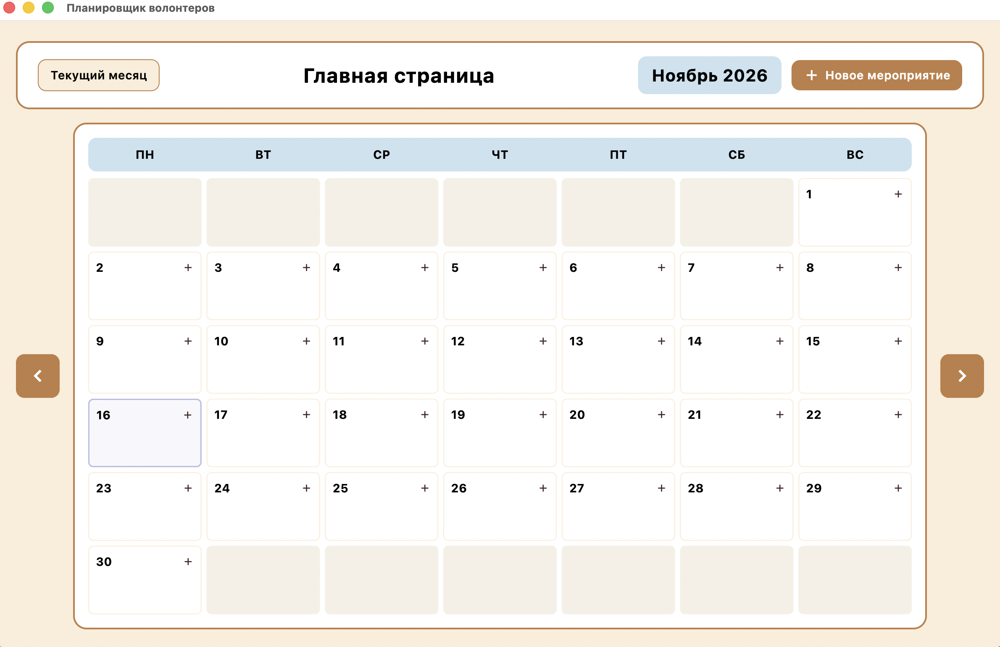
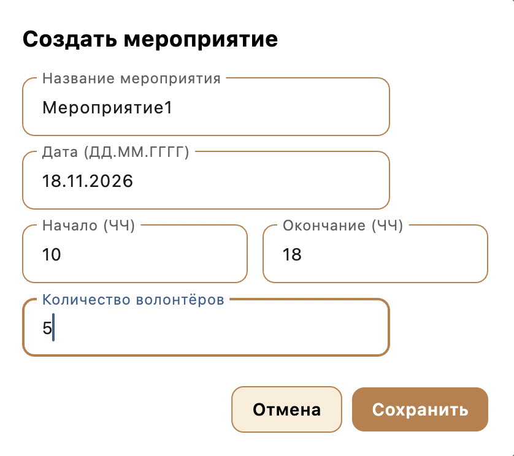
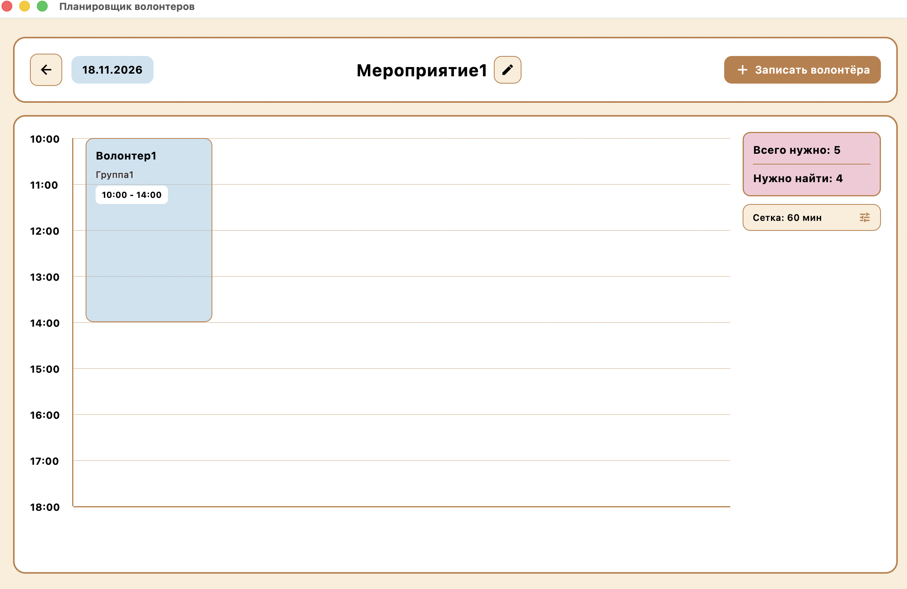

# Планировщик волонтёров

Локальное десктопное приложение для координации волонтёров на мероприятиях: ведение календаря событий, распределение смен по времени и контроль набора команды.

## Основные возможности

* **Календарь мероприятий** — навигация по месяцам, выделение сегодняшнего дня, быстрое создание события по клику на любую дату или через кнопку в шапке.
* **Таймлайн смен** — наглядная почасовая сетка с карточками волонтёров (ФИО, академическая группа, время смены) и гибкой настройкой шага сетки в минутах.
* **Контроль набора** — автоматический подсчёт того, сколько волонтёров уже записано и сколько ещё нужно найти.
* **Редактирование в один клик** — изменение параметров мероприятия, перенос времени смен и удаление записей.
* **Локальное хранение данных** — у каждого пользователя свой независимый календарь. Все данные сохраняются локально в домашней папке (`~/VolunteersPlanner/events.json`) и никуда не отправляются.

## Скриншоты


Главная страница календаря

Создание нового мероприятия

Страница расписания смен

## Установка и запуск

Готовые установщики для Windows и macOS доступны во вкладке **[Releases](../../releases)** справа на странице репозитория.

### Windows
1. Скачайте файл **`VolunteersPlanner-Setup.exe`** из последнего релиза.
2. Запустите установщик и следуйте подсказкам мастера установки. *(Если Windows SmartScreen покажет предупреждение о неизвестном издателе, нажмите **«Подробнее» → «Выполнить в любом случае»**).*
3. Запустите программу с ярлыка на рабочем столе или из меню «Пуск».

### macOS
1. Скачайте образ **`VolunteersPlanner-macOS.dmg`** из последнего релиза.
2. Откройте его и перетащите приложение в папку **Applications («Программы»)**.
3. При первом запуске, если система предупредит о неизвестном разработчике, нажмите на иконку правой кнопкой мыши (или с зажатой клавишей `Control`) → **«Открыть»**.

## Запуск из исходного кода

Требуется Python 3.10 или новее:

```bash
pip install -r requirements.txt
python main.py
